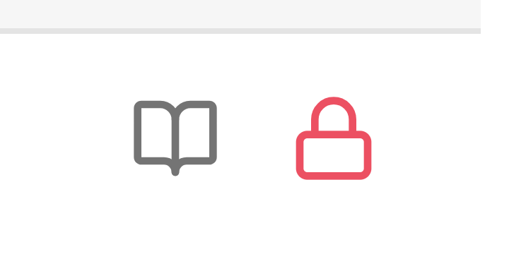
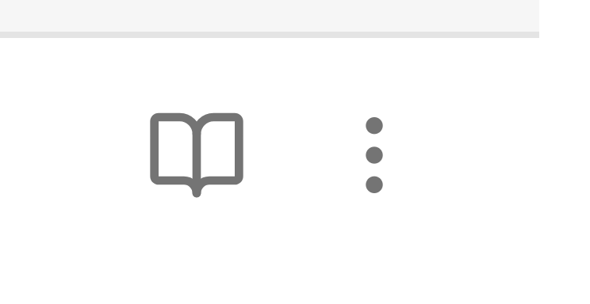

# Pin Indicator

**[English](README.md) | [简体中文](README.zh-CN.md)**

Show a lock icon in the note's more options button while the note is pinned.

---

## The problem

Obsidian has a **Pin** feature that keeps a tab from being closed. The only hint that a note is pinned is a small icon in the tab bar.

On a phone the tab bar is narrow enough that the hint is effectively invisible — you have no way to tell at a glance whether the note you are looking at is pinned or not.

## What this plugin does

While the current note is **pinned**, the `⋯` button in the top-right corner of the note header:

- switches to a **lock icon**
- turns **red**

Unpin the note and the button goes back to its normal three dots and default color.

| Not pinned | Pinned |
|:---:|:---:|
|  |  |

The button keeps working as a menu — only its icon and color change.

---

## Usage

Nothing to configure.

1. Open a note.
2. Pin the tab. Either right-click the tab and choose **Pin**, or run the **Toggle pin** command from the command palette.
3. The `⋯` button in the note header turns into a red lock icon.
4. Unpin the tab and it returns to normal.

---

## Installation

### From the community directory

Search for **Pin Indicator** in **Settings → Community plugins → Browse**.

### Manually

1. Download `main.js`, `manifest.json` and `styles.css` from the [latest release](../../releases/latest).
2. Create the folder `<your vault>/.obsidian/plugins/pin-indicator/`.
3. Copy the three files into it.
4. Reload Obsidian.
5. Enable **Pin Indicator** in **Settings → Community plugins**.

### From source

There is no build step — `main.js` is the source. Copy the three files as described above.

---

## How it works

Obsidian exposes the more options button of each view as `view.moreOptionsButtonEl`, and each leaf carries a `pinned` flag. The plugin reads that flag, swaps the button icon with `setIcon`, and toggles a CSS class that colors the button.

It listens on each leaf's `pinned-change` event, plus the workspace `layout-change` and `active-leaf-change` events, and re-applies the state a couple more times shortly after a change in case Obsidian's own header update overwrites the icon. There is no polling and no background work.

### Why not a CSS snippet

Obsidian only applies `.is-pinned` to side drawers. There is no ancestor class on the tab itself, so pure CSS cannot select "the `⋯` button of a pinned tab", and `:has()` is not reliable on mobile.

---

## Compatibility

- Works on desktop and mobile (`isDesktopOnly: false`).
- Requires Obsidian 1.4.0 or newer.
- No third-party dependencies — the only `require` is the host `obsidian` module.
- No network access, no telemetry, no filesystem access.
- No settings, no data stored.

---

## Naming

Obsidian's own UI calls this feature **Pin** in English and **锁定** in Chinese. Both mean the same thing: the tab is kept from being closed. This plugin does not lock or protect anything — it only makes the pinned state visible.

---

## Relationship to existing plugins

Several community plugins deal with pinned notes, but none of them surface the native pinned state in the note itself.

| Plugin | What it does | Why it is not the same |
|---|---|---|
| Pinned Tabs Customizer | Custom icons for pinned tabs | Styles the **tab bar**; desktop only |
| Pinned Tabs Row · Pinned Tabs · Shrink pinned tabs · Pinned Tab Utils | Change how pinned tabs look or behave | Tab bar appearance |
| Pin Enhancer · Pin Tab Guard · Real Pin | Prevent a pinned tab from being closed | Do not show the state |
| Pins Save · Pinned Daily Notes | Restore pins after a restart | Does not show the current state |
| Pinned Files · Pinit · Pinup · Pin to Top · Star Pins · Folder Pin | Pin items to the top of the file explorer | Maintain their **own** pin list, unrelated to Obsidian's native pin |
| Pinned Notes · New Tab Pins | Pin notes to the ribbon or a launcher | Own list |

Obsidian itself renders no pin indicator in a note's view header — the tab bar hint is the only cue, and on mobile that hint is effectively invisible.

This plugin reads Obsidian's own `leaf.pinned` flag and reflects it on the note's more options button. It stores nothing and keeps no list of its own.

---

## FAQ

**Does it prevent the note from being closed?**
No. It only shows the pinned state. Preventing a pinned tab from closing is Obsidian's own behavior.

**Does it work with multiple panes?**
Yes. Each leaf is tracked separately.

**Does unpinning remove the lock icon immediately?**
Yes.

**Why does my button show a lock even after I closed the tab?**
It should not — the class is re-evaluated on every layout change. If it does, please open an issue.

---

## License

MIT — see [LICENSE](./LICENSE).

---

**[English](README.md) | [简体中文](README.zh-CN.md)**
